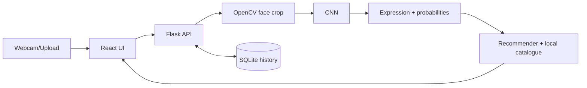

# Mood-Based Music Recommendation System Using Deep Learning

**Status:** training and evaluation are PENDING. No model is shipped and no accuracy is claimed. The app shows "model missing" until you train one.

## Abstract / Problem / Objective
Facial expressions can hint at a listener's state, but picking music by hand is tedious. This project classifies a face image into 7 expression classes (angry, disgust, fear, happy, neutral, sad, surprise) with a CNN and recommends songs via an explainable rule engine. Outputs are *predicted expression categories*, not diagnoses of emotion.

## Dataset & preprocessing
FER-2013 (48x48 grayscale, Kaggle `msambare/fer2013` image folders). Preprocessing: Haar-cascade face detection (OpenCV), crop largest face, histogram equalisation, resize 48x48; scaling by 1/255 happens inside the model. Augmentation: flip, rotation, zoom. Validation = 15% of train; test folder is held out.

## CNN, training, evaluation
Conv32x2 -> Pool -> Drop -> Conv64x2 -> Pool -> Drop -> Conv128 -> Pool -> Drop -> Dense256 -> Drop(0.5) -> Softmax(7). Adam + sparse categorical cross-entropy, EarlyStopping + best checkpoint, seed 42. `evaluate_model.py` computes accuracy, per-class precision/recall/F1, macro-F1, confusion matrix into `models/metrics.json`.

## Architecture


## Recommendation algorithm
Each song has tags. Each expression maps to tags (`MATCH`), and each goal (relax, energize, uplift, comfort) maps to tags (`GOALS`) in `recommender.py`. Score = number of overlapping tags; filters: genre, energy, language. Each card shows the reason. Rules are heuristic, not scientific. Links are YouTube *search* URLs (no invented streaming links).

## Database
SQLite `backend/mood_history.db`: `history(id, ts, emotion, confidence, source, goal, songs)`. No images stored. Clear via History page or `DELETE /api/history?confirm=true`.

## Accounts, security, languages (v2)
- Register/login/logout with Flask sessions: passwords hashed (Werkzeug scrypt), HTTP-only SameSite=Lax cookie, CORS only for localhost:5173 with credentials, Origin check on writes. Secret: `SECRET_KEY` env var, else a random key is generated once in `backend/.secret_key` (gitignored).
- Dev limitations: cookie is not `Secure` over http, no rate limiting or email verification. For production set `SECRET_KEY`, `COOKIE_SECURE=1`, serve over HTTPS, and add rate limiting.
- History is per user. Existing rows from v1 are kept (user_id NULL, not shown to anyone).
- Predictions are the ONLY source of recommendations/history: `/api/predict` returns a signed, user-bound token (15 min) that `/api/recommendations` requires, so records cannot be forged. Upload and manual expression selection were removed.
- Catalogue: Telugu, Hindi, English (+ instrumental, shown under All/English). Listen links are YouTube *search* URLs built from title and artist; they are not individually verified. Replace with official links in `recommender.py` if desired.

## Run (Windows PowerShell)
```
cd backend
python -m venv venv; venv\Scripts\activate
pip install -r requirements.txt
python -m unittest discover -s tests -v      # or: pytest
python train_model.py --data data/fer2013    # optional, needs dataset (see data/README.md)
python evaluate_model.py
python app.py                                # http://localhost:5000
```
New terminal:
```
cd frontend
npm install
npm run dev                                  # http://localhost:5173
```
Use Python 3.10-3.12 (TensorFlow does not support newer versions on Windows). Troubleshooting: camera denied -> browser site settings, or use upload; port 5000 busy -> change `app.run(port=...)` and `VITE_API_URL`; "Model missing" -> train first.

## API
GET `/api/health` · GET `/api/model/status` · POST `/api/auth/register|login|logout` · GET/PATCH `/api/auth/me` · POST `/api/predict` (login; webcam frame; 400 invalid, 422 no face, 503 no model; returns `token`) · POST `/api/recommendations` (login; `token, goal, genre, energy, language, save`) · GET `/api/catalogue` · GET `/api/history` · GET `/api/analytics` · DELETE `/api/history?confirm=true`.

## Screenshots
Run the app and capture: Home, Detect (with result), Music, History, Model pages into `docs/screenshots/`.

## Limitations / Future work
FER-2013 has noisy labels and posed/dataset bias (typical accuracy is far from perfect, especially for disgust/fear); expressions != feelings; Haar cascade is weak for angled faces; small catalogue; no CSV loader. Future: Spotify/YouTube official APIs, MediaPipe/DNN detector, transfer learning, per-user feedback.

## References
Goodfellow et al., FER-2013 challenge (ICML 2013 workshop); Kaggle msambare/fer2013; Keras and OpenCV docs.
